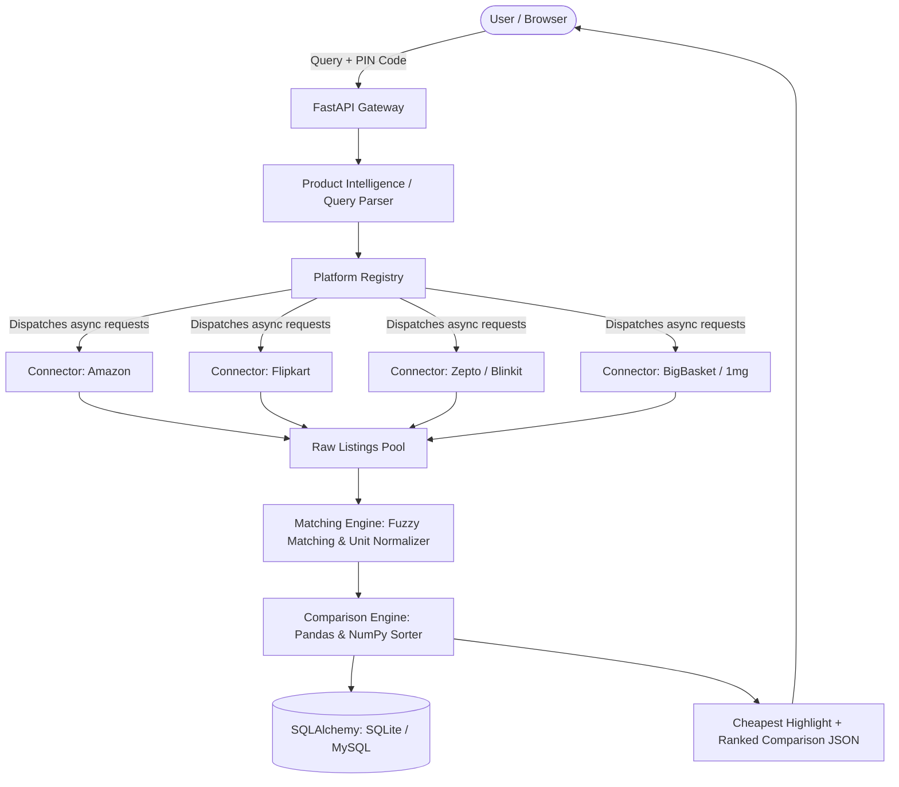

# PricePeek Architecture & Technical Specification

## Overview
PricePeek is an industry-grade Universal Product Price Comparison Platform designed with a modular, plug-and-play backend architecture. It allows live cross-store discovery, intelligent product entity resolution, unit normalization, discount computation, and direct deep-linking across varied commercial platforms (e-commerce, quick commerce, pharmacy, groceries, electronics, and fashion).

## System Components

1. **Product Intelligence Layer (`backend/app/intelligence/`):**
   - Universal query tokenizer and parser.
   - Deterministic regex and lookup tables for units (e.g. `1000ml` -> `1.0 L`, `1 kg` -> `1000 g`, `256gb` -> `256 GB`).
   - Attribute and variant extraction (storage, colors, sizes, volume).

2. **Dynamic Platform Registry (`backend/app/registry/`):**
   - Registry manager where connectors register with metadata (platform name, category capabilities, PIN code support, status).
   - Dynamic connector discovery without modifying search routes.

3. **Connectors (`backend/app/connectors/`):**
   - Abstract Base Connector (`BaseConnector`) returning standardized `RawProductListing`.
   - Adherence to `PROJECT_SOP.md` ethical collection guidelines and fallback indicators.

4. **Matching & Comparison Engine (`backend/app/matching/` & `backend/app/comparison/`):**
   - String similarity scoring (`rapidfuzz` token sort / set ratio).
   - Strict unit separation (e.g. 500ml is isolated from 1L; 128GB isolated from 256GB).
   - Numerical vector processing with Pandas/NumPy for price rankings, savings calculations, and lowest price badges.

5. **Data Persistence (`backend/app/models/` & `backend/app/config/database.py`):**
   - Dual-engine SQLAlchemy 2.0 supporting zero-block SQLite development and immediate switch to production MySQL.
   - Products, platform registrations, historical price records.
